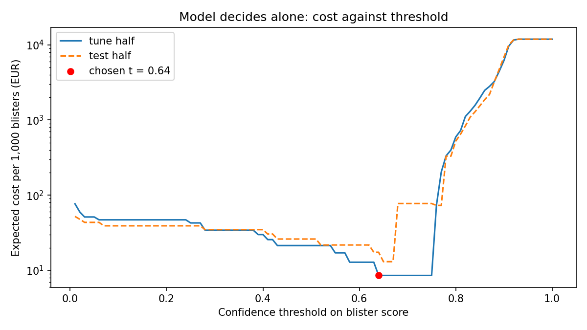

# Assignment 2 Report

- **Name**: Marcela Mendes Gimenes Funabashi
- **Student ID**: 20251
- **Email**: mmendesgimen.ieu2022@student.ie.edu 
- **Group**: BBADBA 5A

## Business problem, and the cost of being wrong

During my summer internship at Brazil’s largest pharmaceutical company, I learned how important it is to detect manufacturing defects immediately and precisely. These laboratories produce at a very large scale to take advantage of economies of scale, with packaging lines running hundreds of blisters per minute. At the same time, they operate in one of the most critical and highly regulated industries in the country. This model supports one specific decision: whether each blister leaving the packaging line is intact and contains all of its pills, or whether it should be rejected. Blisters the model is confident are defective are automatically rejected from the line, and blisters it is unsure about are sent to a quality control operator for manual inspection. The model can be wrong in two directions, and with unequal magnitudes. A false positive (rejecting a blister that was actually fine) only costs the value of that blister and a few seconds of an operator’s time, which is a matter of cents. A false negative (letting a blister with missing pills reach the market) is a much more expensive mistake. A patient could take an incomplete treatment without noticing, the company could be forced into a batch recall, face sanctions from ANVISA and suffer lasting damage to its reputation and trust with pharmacies and doctors. Missing one defective blister can cost much more than wrongly rejecting a good one. For this reason, the model should be built to catch as many defective blisters as possible, even if that means rejecting or reviewing more good ones. Recall (sensitivity) on the defective class is therefore the metric this analysis should prioritize, and the decision threshold should be set low enough to keep missed defects close to zero, while keeping the number of blisters sent to manual review manageable for the operators.

## Dataset

To train and evaluate this model, I used the pill dataset published on Roboflow Universe by the workspace zhaosi-nicholas-z2xrh, project pill-j8vgy, version 63 (https://universe.roboflow.com/zhaosi-nicholas-z2xrh/pill-j8vgy/dataset/63), which is available under a CC BY 4.0 license. I chose this version because it is the largest one available, with 1,645 images (1,045 for training and 600 for validation), it applies no augmentation, and its only preprocessing step removes a class that drew a single box around the whole package, which is not needed for this decision. Each image shows one blister pack photographed inside a fixed inspection setup, with lighting and either white/dark background. The pack is seen either from the front (the plastic cavity side) or from the back (the aluminium foil side). Every individual pocket is annotated with a bounding box and one of four classes: pill_front and nopill_front (a pocket with or without a pill, seen from the front), and pill_back and nopill_back (seen from the back, where the pill either still presses against intact foil or the seal is broken and the pill is gone). This structure translates directly into the decision described above: a blister is defective if at least one of its pockets is detected as nopill_front or nopill_back, and intact only if every pocket contains a pill, so the recall I prioritize is measured on these two “nopill” classes. This is what makes the dataset actually serve the problem rather than merely resemble it. Most pill datasets on Roboflow are built to identify which medicine a pill is or to count loose pills, while this one labels exactly the defect that leads to the expensive false negative, a missing pill inside a sealed blister. It also covers both sides of the pack, like real packaging lines do, and it was captured in a controlled setup that is much closer to an inline vision station than casual photos. Since the provided split has no test set, the 600 validation images were divided in half, using one half to choose the decision threshold and keeping the other half untouched for the final evaluation, so the recall I report is not measured on the same images I used to tune it. 86 label files (43 from train and 43 from valid sets) had mixed polygon and boxed annotations which Ultralytics would drop the images for. Therefore, these were converted to boxes so all 1645 images were used. An initial analysis also showed that there were near-duplicates for only 2-3 valid images, so leakage was negligible, but the same products would appear in both splits meaning that the test can't show how the model handles new products. The dataset still has limitations, such as that the images are still frames rather than footage from a line running hundreds of blisters per minute, and the empty back-side pockets show pills that were pushed out rather than never filled. For these reasons, the results should be read as a proof that the approach works, and a real deployment at a company would still require fine-tuning on images from its own packaging lines.

## What the dataset's composition implies

Version 63 contains 1,645 images and 21,794 annotated pockets. The training set has 1,045 images and the validation set has 600, with no test set provided. I split the 600 validation images at random into two halves of 300 images each, using a fixed random seed so the split can be reproduced. The tuning half was used to 1) choose the best training epoch (early stopping) and 2) choosing thresholds, and the other was kept untouched as the test set. The classes are very unevenly represented. In training, pill_front has 8,479 instances, nopill_front 2,821, pill_back 1,613 and nopill_back only 276. Most of the pockets are also small: a typical pocket covers only 0.4% to 0.7% of the image area, or about 6% to 8% of the image width. The smallest tenth cover less than 0.2%. The model will therefore have to detect small details in each frame, and empty pockets are among the hardest to see. Because my decision is made blister by blister, what really matters is how many defective blisters each split contains. The validation set has 368 defective and 232 intact blisters, so each half will hold around 185 defective blisters. Missing a single defect will then lower recall by about half a point. That is precise enough to compare thresholds on the front side of the pack. On the other hand, the back side has only 42 training images and 15 validation images containing a nopill_back pocket, which leaves around 7 or 8 per half. Recall on back-side defects would increase by more than 10 points with every miss, so I will not treat that number as reliable and will report it only for reference. The test set will also differ from what the line would really see in two important ways. First, 61% of the validation blisters are defective. On a real packaging line, the defect rate is a small fraction of one percent. This means I will be able to measure recall, but I will not be able to use these images to estimate how many good blisters would be rejected or sent to the operators for every defect caught. In production, that review load would be much higher than the test set suggests. What I therefore cannot conclude from my results is how the model would perform on a real production line. That includes its recall on back-side defects, the review workload it would create for the operators, and how well it would handle new products and packaging formats that it has not seen before.

## Finetuning and baselines

I treated this as an object detection task rather than an image classification task. The labels in the dataset are given per pocket, and my decision rule is that a blister is defective if any of its pockets is empty. A detection model can find the empty pocket itself, while a classifier would have to judge the whole image at once. Since one empty pocket covers only about 0.5% of the image, a whole-image classifier would struggle to notice it. I chose yolo11s over the smaller yolo11n because it performs better on small objects, and training time was not a constraint on Google Colab.

I trained the model on a Google Colab T4 GPU with Ultralytics 8.4.190, starting from the COCO pretrained weights. I trained for up to 50 epochs and stopped early if there was no improvement for 20 epochs. The image size was 640, the batch size 16, the optimizer AdamW (chosen automatically by Ultralytics), the initial learning rate 0.00125 and the seed 0. I only used the default Ultralytics augmentations: mosaic, horizontal flips, colour changes, scaling and small translations, with no rotation or vertical flips. The dataset itself had no augmentation. The images were already shrunk to 640 pixels beforehand, so the model input stayed the same. I kept the checkpoint with the best mAP50-95 on the tuning half, which was the one from the last epoch (epoch 50), with an mAP50-95 of 0.658 and an mAP50 of 0.965. Early stopping never triggered, and the full training took about 15 minutes. Since the model was still slowly improving at the end, training for more epochs could have given slightly better results.

I compared the finetuned model with the pretrained COCO model used zero-shot and with two trivial baselines, all on the same 300-image test half. All results are at the blister level, and the cost per 1,000 blisters is calculated with the cost matrix and the 0.1% base rate explained in the cost section.

| Model (test half, 185 defective / 115 good) | Threshold | Defects caught (TP) | Defects missed (FN) | Good rejected (FP) | Good passed (TN) | Recall | Precision | Accuracy | Cost per 1,000 blisters |
|---|---|---|---|---|---|---|---|---|---|
| **Finetuned yolo11s** | 0.64 | 185 | 0 | 4 | 111 | **100%** | 97.9% | 98.7% | **€17.37** |
| COCO yolo11s, zero-shot | 0.64 | 0 | 185 | 0 | 115 | 0% | – | 38.3% | €11,900.00 |
| Trivial: pass everything (production majority) | – | 0 | 185 | 0 | 115 | 0% | – | 38.3% | €11,900.00 |
| Trivial: reject everything (test-set majority) | – | 185 | 0 | 115 | 0 | 100% | 61.7% | 61.7% | €499.50 |

I included two trivial baselines because the majority class is different on the test set and on a real line. On the test set, 61% of the blisters are defective, so “reject everything” is the majority-class baseline. On a real packaging line, almost all blisters (99.9%) are good, so “pass everything” is what a majority-class model would actually do in production.

The finetuned model caught all 185 defective blisters and only rejected 4 of the 115 good ones. The COCO model failed and this was expected. COCO has no class for an empty pocket and was trained mostly on everyday objects like bottles, remotes and fridges, so it never flags a defect and ends up with exactly the same result as passing everything. This shows that finetuning is necessary for this problem. The more interesting comparison is with “reject everything”. It also reaches 100% recall, but it costs around 29 times more than the finetuned model, because it throws away every good blister. This shows that recall alone is not the goal. High recall only has value if it comes with an acceptable cost of false positives, and the finetuned model is the only option that achieves both.

## Per-class evaluation and failure modes

At the blister level, the positive class is a defective blister. At the box level, the positive classes are the two empty-pocket classes, nopill_front and nopill_back. Overall, the model reaches an mAP50 of 0.974 and an mAP50-95 of 0.661 on the test half.

**Per-class box metrics, finetuned yolo11s, test half**

| Class | Test instances | Precision | Recall | AP50 | mAP50-95 |
|---|---|---|---|---|---|
| nopill_back | 45 | 0.91 | 0.93 | 0.98 | 0.57 |
| nopill_front | 784 | 0.97 | 0.99 | 0.99 | 0.83 |
| pill_back | 337 | 0.94 | 0.80 | 0.93 | 0.49 |
| pill_front | 2,750 | 1.00 | 0.99 | 0.99 | 0.76 |
| **All classes** | 3,916 | 0.95 | 0.93 | **0.97** | **0.66** |

**Box confusion matrix, test half, confidence 0.25** (rows: predicted class, columns: true class)

| Predicted \ True | nopill_back | nopill_front | pill_back | pill_front | background |
|---|---|---|---|---|---|
| nopill_back | **44** | 0 | 2 | 0 | 9 |
| nopill_front | 0 | **781** | 0 | 21 | 16 |
| pill_back | 1 | 0 | **315** | 0 | 82 |
| pill_front | 0 | 1 | 0 | **2,726** | 11 |
| background (missed) | 0 | 2 | 20 | 3 | – |

The headline numbers are carried by the front-side classes, which make up most of the instances. pill_front alone represents about 70% of all the test boxes. The two back-side classes are the ones dragging performance down. pill_back has the lowest recall (0.80) and the lowest mAP50-95 (0.49). nopill_back has only 45 test instances, and while its AP50 is high (0.98), its mAP50-95 is much lower (0.57). This means the model finds most of these empty back pockets, but the boxes it draws around them are not very precise. The back side is harder because, on the foil, a full pocket appears only as a small bump rather than a visible pill.

The confusion matrix (at a confidence of 0.25) shows what the model actually mixes up. 21 full front pockets were predicted as empty, and these are the errors that lead to good blisters being rejected. On the back side, the model predicted 82 “pill” boxes where there was no pocket at all, and it missed 20 real back pockets completely. In the dangerous direction, 1 empty back pocket was called full, 1 empty front pocket was called full, and 2 empty front pockets were not detected at all. These box-level misses rarely turn into blister-level misses, because most defective blisters have several empty pockets, and the model only needs to detect one of them to flag the blister. The risky case is a blister with exactly one empty pocket.

One method note: Ultralytics reports the per-class precision and recall at the confidence that maximises F1, and the confusion matrix at 0.25. Neither of these is my operating threshold, so the blister-level results are the ones that matter for the decision.

At the blister level, split by side, the model caught all 178 defective front-side blisters on its own. On the back side, it also caught all 7 defective blisters, but with so few cases, the 95% confidence interval for recall runs from 65% to 100%. As I expected in the dataset composition section, this interval is too wide to trust.

The hardest cases show where the model breaks. The only defect that the final design let through was a clear blister with dark pills, photographed in a different setup with a dark background, and with exactly one empty pocket in the corner. The good blisters with the highest scores are both amber or tinted blisters, where the pills are hard to see through the plastic, so the model calls several pockets empty. Another image also is a clear blister photographed with backlighting. The pattern is that the model struggles with tinted plastic and unusual setups or lighting. Blisters with a single empty pocket are its most expensive weakness, since that is the case where one missed box becomes one missed defect.

## Cost matrix and operating point

I assigned a euro cost to each of the four possible outcomes for a blister. These figures are my own estimates from what I remember from my internship complemented by some research, built to reflect the reasoning in the business problem section.

| Outcome | Decision | Cost per blister | Where the figure comes from |
|---|---|---|---|
| False negative | Defective blister passed | **€11,900** | Expected value of the consequences of one escaped defect (breakdown below) |
| False positive | Good blister rejected | €0.50 | Production cost of a branded blister plus pharmaceutical waste disposal |
| True positive | Defective blister rejected | €0 | The blister is lost whatever happens, so rejecting it adds no cost |
| True negative | Good blister passed | €0 | Normal production |
| Manual review | Any blister sent to an operator | €0.015 | About 10 seconds of an operator at about R$30/h loaded (≈ €5/h) |

**Building the false negative cost** (Brazilian figures converted at about R$6 = €1)

| Consequence of one escaped defective blister | Probability | Cost if it happens | Expected cost |
|---|---|---|---|
| Complaint investigation (QA, batch record review, CAPA) | 10% | €1,500 | €150 |
| Batch recall (retrieval from pharmacies, destruction, lost batch) | 1% | €1,000,000 | €10,000 |
| ANVISA sanction (top of the Lei 6.437/1977 range, about R$1.5M) | 0.5% | €250,000 | €1,250 |
| Patient harm and liability | 0.1% | €500,000 | €500 |
| **Total false negative cost** | | | **€11,900** |

The true positive costs nothing because a defective blister is lost whatever happens, so rejecting it adds no extra cost. I assumed a base rate of 0.1%, meaning one defective blister in every 1,000. Since 61% of the test blisters are defective, I reweighted the costs from the test set to this production base rate. The key ratio is 0.001 × €11,900 ÷ (0.999 × €0.50), which is about 24. In other words, even though defects are very rare on a real line, the expected cost of missing them is still around 24 times larger than the expected cost of rejecting good blisters. This is what makes missed defects dominate the decision. The conclusion holds as long as the false negative cost stays above about €500 at this base rate.

I then swept the threshold for the model alone and calculated the cost per 1,000 blisters at each value. On the tuning half, the cost has a flat minimum of €8.54 per 1,000 between thresholds of 0.64 and 0.75. In the case of a tie, my pipeline takes the lowest threshold, so the chosen operating point is 0.64. On the test half, this gives a cost of €17.37 per 1,000. The test curve jumps at 0.68, because of the defective blister with a score of 0.673. Taking the left edge of the flat area happened to give a safety margin here: with a threshold of 0.70, the test cost would have been around €77 per 1,000. The lowest test cost is €13.03 between 0.65 and 0.67, but I did not change my threshold based on the test half. The shape of the curve also matches the framing of the problem. Above about 0.75, the cost rises steeply towards €11,900, while below 0.64 it only rises slowly. Lowering the threshold costs cents, while raising it can cost a lot.

The assumption that would most change my answer is the 1% probability of a recall when a defect escapes. This single term makes up about 84% of the false negative cost. If it were 0.1% instead, the false negative cost would drop to about €2,900 and the ratio to about 6. Missing defects would still be the more expensive mistake, so the conclusion would hold. If the base rate were also ten times lower (0.01%), the ratio would drop to about 2.4. The sensitivity analysis gives the same thresholds in every scenario, but not because the costs don’t matter. The tuning half has no defect with a score below 0.75, so no value of the false negative cost ever produces an observed miss there. This is an important limitation of choosing thresholds on so few defects.

## What a person still has to check

The final design uses two thresholds, chosen on the tuning half. Blisters with a score below 0.75 pass, blisters between 0.75 and 0.88 are sent to an operator for review, and blisters at 0.88 or above are rejected automatically. On the test half, out of 185 defective blisters, 1 passed, 49 were reviewed and 135 were rejected. Out of 115 good blisters, 112 passed, 3 were reviewed and none were rejected.

Reweighted to the 0.1% base rate, about 2.63% of production would go to review. A line running 300 blisters per minute over two 8-hour shifts produces about 288,000 blisters a day, so this means about 7,600 reviews a day. At around 10 seconds per review, that is about 21 hours of review work a day. With two shifts of 7 productive hours, this needs about 1.5 operators per shift, so I would staff 2 operators per shift.

In terms of headcount, this is realistic, but there are a few practical issues. First, nobody can review blisters inline at 300 per minute, so the line needs a diverter that moves the uncertain blisters into a hold bin for offline review. Second, a machine fault would create a sudden burst of defects. Most of them would score above 0.88 and be rejected automatically, but around 26% of defects fall in the review band, so a burst would quickly fill the review queue. Third, the design assumes that reviewers are always right, which won’t be true over a full shift.

I priced this design against the three alternatives, using the same costs and base rate.

| Design (test half, reweighted to a 0.1% base rate) | Cost per 1,000 blisters | Cost per day (288,000 blisters) | Share sent to review | Reviews per day | Operators per shift | Defects passed unchecked | Good blisters rejected |
|---|---|---|---|---|---|---|---|
| Do nothing (pass everything) | €11,900.00 | ≈ €3,427,000 | 0% | 0 | 0 | 100% | 0% |
| A person checks everything | €15.00 | ≈ €4,300 | 100% | 288,000 | 57.1 | 0% | 0% |
| Model decides alone (threshold 0.64) | €17.37 | ≈ €5,000 | 0% | 0 | 0 | 0% | 3.48% |
| **Model + review band (0.75–0.88)** | **€64.72** | ≈ €18,600 | 2.63% | ≈ 7,600 | 1.5 | 0.54% | 0% |

Doing nothing is clearly not an option, with an expected cost of around €3.4 million a day. Having a person check every blister is the cheapest option in euros, but it needs 57 operators per shift and assumes they stay accurate all day, which is not realistic. The model alone throws away about 3.5% of good blisters, around 10,000 a day, which is where its €5,000 a day comes from. The model with the review band is the most expensive design on the test half, and almost its entire cost comes from the one defective blister it let through. At a 0.1% base rate, this would mean about 1 to 2 defective blisters reaching the market every day. This happens because its lower threshold of 0.75 sits above the 0.673 defect. The tuning half had no defect below 0.75, so the cost minimisation pushed the lower edge up as far as it could go, with no margin.

The size of this margin effect is large. As a post-hoc illustration on the test half, and not a threshold I chose on it, a band with its lower edge at 0.30 costs €1.03 per 1,000 on the tuning half and €1.05 on the test half. It misses no defects, sends about 7% of production to review and needs about 4 operators per shift. That is cheaper than every other design, at the price of two more operators per shift.

My recommendation is that the model is good enough to ship as a supervised pilot, but not yet to run on its own. Since recall on defective blisters is my priority metric, I would ship the model with a review band, but with the lower threshold set with a deliberate safety margin rather than at the edge of the tuning results. That margin should then be confirmed on a new held-out set before going live. The front side of the pack is ready for this pilot. The back side and new products should stay under full manual checking until there is enough data to measure them properly.

## Limitations & next steps

The biggest limitation is that the thresholds have no safety margin. They were chosen on only around 185 defects, and none of them scored below 0.75, which is why the band missed a defect on the test half. With more time, I would collect more defective images, set the lower threshold with a deliberate margin and confirm it on a new held-out set. The tuning results are also optimistic, since the same tuning half was used to choose both the checkpoint and the thresholds. The band costs €0.26 per 1,000 there, against €64.72 on the test half, so I would use separate sets for each job. Some parts of the problem are also barely tested. There are only 7 back-side defects in the test half, with a 95% interval of 65% to 100%, and the same products appear in both the training and test sets. I would collect more back-side defects and hold some products out completely to see how the model handles new packaging. Most of the errors come from tinted blisters and unusual setups or lighting, so I would add more of these images and use controlled lighting or backlighting on the line.

The results are also based on still images rather than a running line. Inference took about 8 milliseconds per image on a T4 GPU, well within the 200-millisecond budget, but I haven’t tested it on line hardware or on video with motion blur. Several assumptions also come from my own estimates rather than real data: the 0.1% base rate, the cost figures (especially the 1% probability of a recall) and the idea that reviewers are always right. I would validate them with real reject logs, the company’s quality and regulatory teams, and measurements of reviewer accuracy. Finally, some labels needed fixing, one amber blister may be mislabelled, and the empty back pockets show pills that were pushed out rather than never filled. I would audit the labels and collect images of real filling defects from the packaging line.

## Generative AI use disclosure

Upon my own determination of the business case, finding and choice of the dataset, and decision making of how to approach (and choice of costs/assumptions), I used Claude Code to develop the code.
